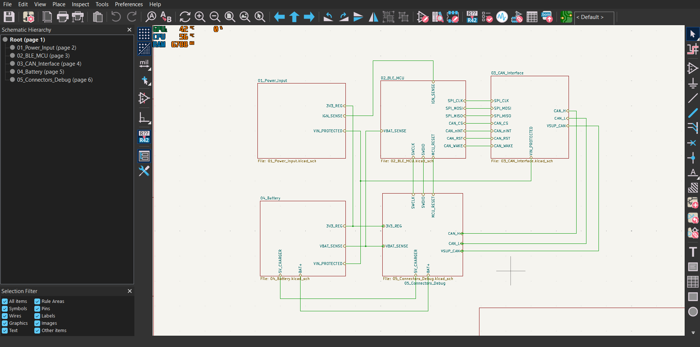
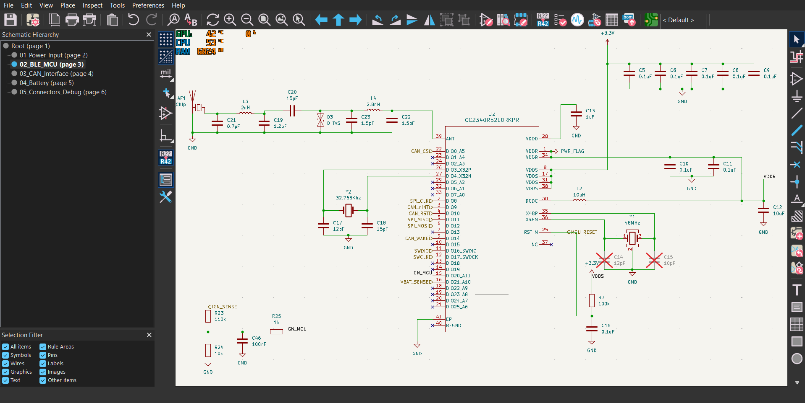
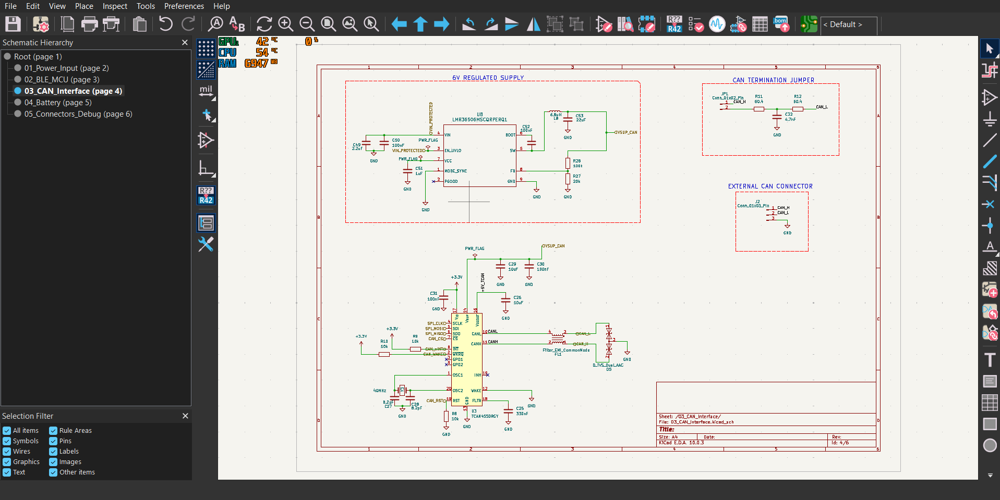
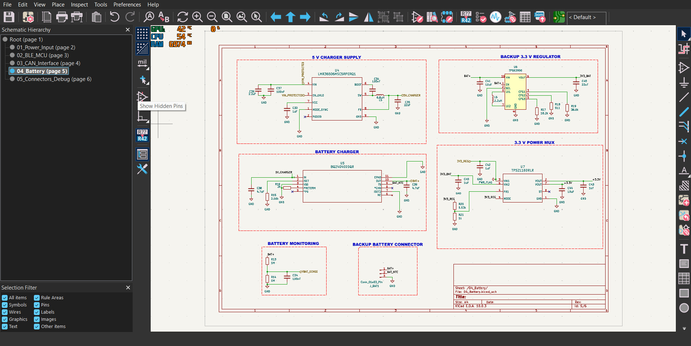
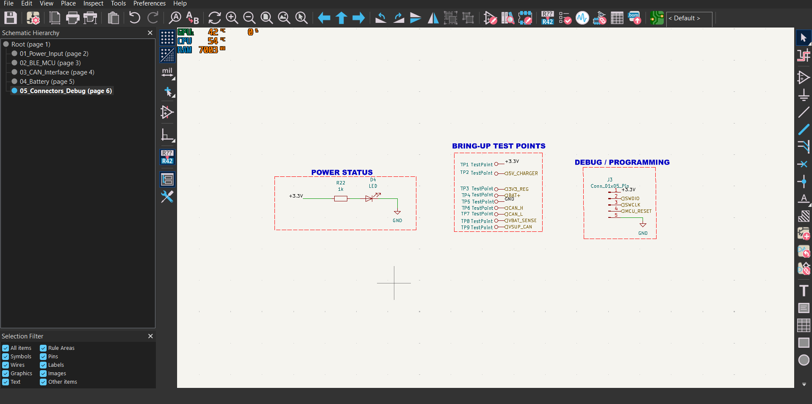
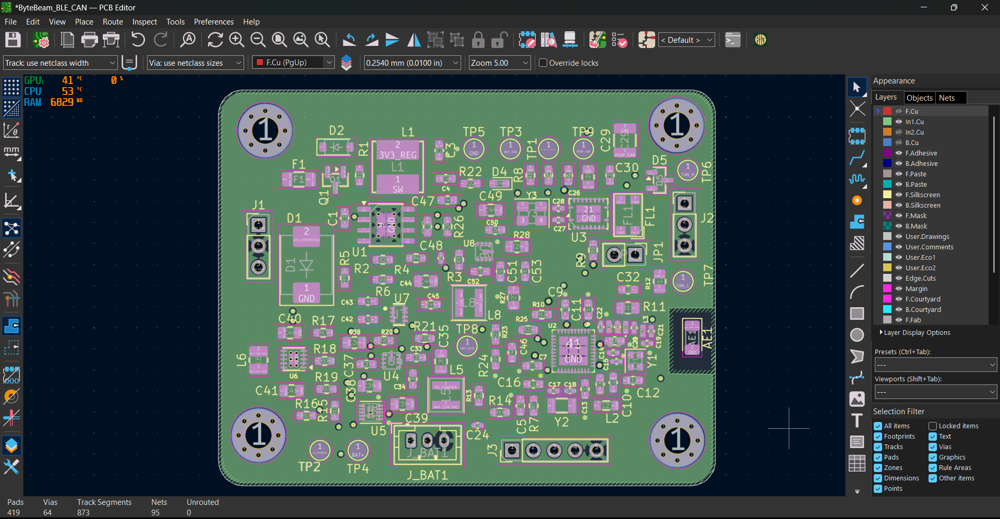
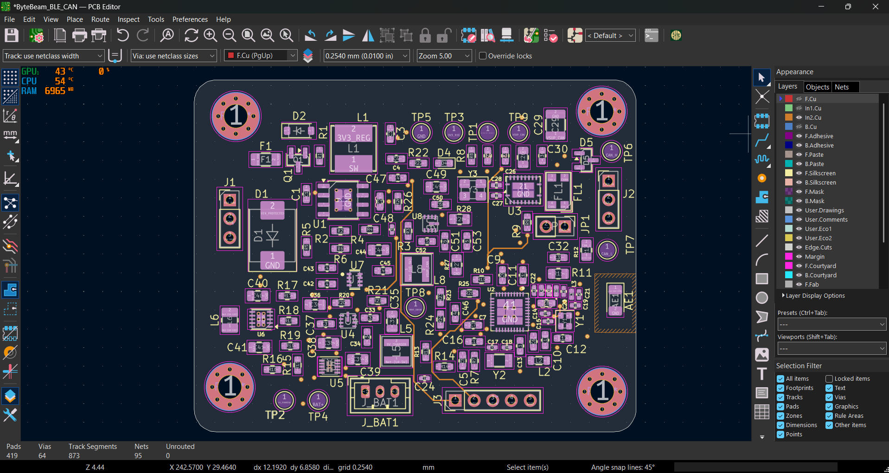

# Automotive BLE-to-CAN Hardware Gateway
### Connected Vehicle Telematics & High-Speed CAN FD Interface Module

<div align="center">


-gold)
-blue)
-red)


<br>

| Top View (BLE 5.3 SoC, RF Front-End, Test Points) | Bottom View (Automotive Power Conditioning & Battery) |
| :---: | :---: |
|  |  |

</div>

---

## About the Project

Modern vehicles and commercial fleets produce a wealth of diagnostics and telemetry over internal CAN networks. Accessing and logging that data wirelessly—without bulky external dongles or unreliable power taps—can be a challenge. 

I designed this 4-layer hardware gateway to bridge **CAN Flexible Data-Rate (CAN FD)** networks directly to **Bluetooth Low Energy (BLE 5.3)**. It allows mobile devices, diagnostic tablets, or edge gateways to monitor real-time vehicle telemetry, capture OBD-II/UDS data frames, and stream sensor feeds over a secure wireless connection.

The hardware is built specifically for automotive environments:
- **Wide Input Range (9V–36V):** Runs directly from 12V passenger cars or 24V commercial vehicle batteries.
- **Harsh Electrical Protection:** Protected against reverse polarity, load dump transients, and ESD spikes up to ±30kV on the CAN bus.
- **Seamless Battery Backup:** On-board Li-ion battery backup with automatic hardware switchover (<2 µs failover) ensures uninterrupted logging even when vehicle power cuts out during engine cranking or battery disconnects.

---

## Key Hardware Specifications

| Subsystem | Component / Specification | Key Details |
| :--- | :--- | :--- |
| **Wireless SoC** | **TI CC2340R52E0RKPR** | 48 MHz Arm Cortex-M0+, 512 KB Flash, 36 KB SRAM, BLE 5.3 radio |
| **CAN Controller** | **TI TCAN4550-Q1** | Integrated CAN FD controller & transceiver, up to 5 Mbps, AEC-Q100 Grade 1 |
| **Primary Buck** | **TI LM5164** | 100V wide-input synchronous buck regulator delivering 3.3V logic power |
| **Battery Management**| **TI BQ24040 + TPS63900** | Linear single-cell Li-ion charger with thermal foldback + high-efficiency buck-boost |
| **Power Multiplexer**| **TI TPS2116** | Automatic hardware priority power mux (<2 µs break-before-make switchover) |
| **CAN Supply** | **TI LMR36506** | Dedicated 65V/0.6A synchronous buck providing isolated ~6.0V to CAN transceiver |
| **Reverse Protection**| **Vishay SQ2361AEES** | -60V P-channel MOSFET (dissipates <15 mW under full load) |
| **Overvoltage / ESD** | **Littelfuse SMAJ36CA + Nexperia ESDCAN24** | 36V 400W TVS clamp + ±30kV automotive CAN bus ESD suppressors |
| **RF Front-End** | **Johanson 2450AT18D0100E** | 2.45 GHz ceramic chip antenna with 50Ω CPWG feed and discrete Pi matching |
| **PCB Technology** | **4-Layer FR4 (~1.6mm)** | JLC04161H stackup (1 oz outer / 0.5 oz inner Cu, ENIG finish) |

---

## System Architecture & Power Distribution

The power tree is split intentionally into separate regulators to isolate noisy loads (like CAN bus transceivers) from sensitive high-frequency digital logic and the BLE radio.

<div align="center">
  
</div>

```
┌────────────────────────────────────────────────────────────────────────────────────────┐
│                        9V-36V Vehicle Power Input (J1)                                 │
│  F1 (2A Fuse) ──► D1 (36V TVS) ──► Q1 (P-FET Reverse Clamp) ──► VIN_PROTECTED          │
└────────────────────────────────────────┬───────────────────────────────────────────────┘
                                         │
              ┌──────────────────────────┼──────────────────────────┐
              ▼                          ▼                          ▼
    ┌──────────────────┐       ┌──────────────────┐       ┌──────────────────┐
    │  U1: LM5164      │       │  U4: LMR36506    │       │  U8: LMR36506    │
    │  100V→3.3V Buck  │       │  65V→5V Buck     │       │  65V→6V Buck     │
    │  (3V3_REG)       │       │  (5V_CHARGER)    │       │  (VSUP_CAN)      │
    └─────────┬────────┘       └─────────┬────────┘       └─────────┬────────┘
              │                          ▼                          │
              │                 ┌──────────────────┐                │
              │                 │  U5: BQ24040     │                │
              │                 │  Li-Ion Charger  │                │
              │                 └────────┬─────────┘                │
              │                          ▼                          │
              │                 ┌──────────────────┐                │
              │                 │  J_BAT1 Li-Ion   │                │
              │                 │  3.7V / 4.2V     │                │
              │                 └────────┬─────────┘                │
              │                          ▼                          │
              │                 ┌──────────────────┐                │
              │                 │  U6: TPS63900    │                │
              │                 │  Buck-Boost      │                │
              │                 │  (3V3_BAT)       │                │
              │                 └────────┬─────────┘                │
              │                          │                          │
              ▼ (IN1: Priority)          ▼ (IN2: Backup)            │
    ┌──────────────────────────────────────────────┐                │
    │  U7: TPS2116 Power Mux (<2µs Failover)       │                │
    └──────────────────────┬───────────────────────┘                │
                           ▼                                        │
                 +3.3V System Bus                                   │
              ┌────────────┴────────────┐                           │
              ▼                         ▼                           ▼
    ┌──────────────────┐      ┌──────────────────┐        ┌──────────────────┐
    │  U2: CC2340R52   │◄────►│  U3: TCAN4550-Q1 │◄───────│  CAN FD Bus (J2) │
    │  Arm Cortex-M0+  │ SPI  │  CAN FD Controller│       │  Differential Tx │
    │  BLE 5.3 SoC     │      │  & Transceiver   │        │  ISO 11898-2     │
    └──────────────────┘      └──────────────────┘        └──────────────────┘
```

---

## Schematic Walkthrough

The project is structured in KiCad 10 across 5 hierarchical sheets to keep functional blocks clean, modular, and easy to review.

<details open>
<summary><b>🔍 Click to expand/collapse schematic sheets</b></summary>
<br>

### Root Hierarchical Sheet
Connects the top-level power rails, high-speed SPI bus, CAN differential pairs, and control lines between sheets.


---

### Sheet 01: Vehicle Power Conditioning & LM5164 Wide-VIN Buck (9V–36V)
Handles incoming vehicle power protection: 2A fuse, bidirectional 36V TVS clamp, reverse-polarity P-FET switch, and the high-voltage LM5164 buck converter stepping down to 3.3V logic.


---

### Sheet 02: TI CC2340R52 BLE 5.3 MCU & 50Ω CPWG RF Matching
Features the TI CC2340R52 SoC, decoupling network, crystal oscillators, 50Ω Coplanar Waveguide with Ground (CPWG), discrete Pi matching filter, and ceramic chip antenna with ground keepout.


---

### Sheet 03: TI TCAN4550-Q1 CAN FD Controller & Dedicated Power Stage
Houses the TCAN4550-Q1 CAN FD controller, high-speed SPI interface, common-mode choke (ACT45B), ±30kV ESD clamp, jumper-selectable split termination (JP1), and the dedicated 6V buck supply (U8).


---

### Sheet 04: Li-Ion Battery Charger & Automatic Power Mux
Contains the BQ24040 linear charging IC with NTC thermal foldback, TPS63900 buck-boost regulator (3.3V output from single cell 3.0V–4.2V), and TPS2116 priority power multiplexer for seamless battery failover.


---

### Sheet 05: Connectors & SWD Debug Header
Automotive terminal headers for vehicle power, CAN bus, battery JST connection, and standard SWD/JTAG debug pins for firmware flashing.


</details>

---

## 4-Layer PCB Stackup & Layout

The board uses a standard 4-layer stackup (**JLC04161H-7628**) with 1 oz copper outer layers and 0.5 oz inner layers (~1.6 mm finished thickness, ENIG surface finish).

<div align="center">

| Layer 1: Front Copper (F.Cu - RF CPWG & High-Speed Signals) | Layer 2: Inner Ground (In1.Cu - Solid Ground Plane) |
| :---: | :---: |
|  |  |
| **Layer 3: Inner Power (In2.Cu - Power Polygons)** | **Layer 4: Bottom Copper (B.Cu - Low-Speed Signals & GND)** |
|  |  |

</div>

| Layer | Type | Copper | Function & Routing Strategy |
| :--- | :--- | :---: | :--- |
| **L1 (Top)** | Signal | 1 oz (35 µm) | 50Ω CPWG RF feed to chip antenna, high-speed SPI lines, IC placement |
| **L2 (Inner 1)**| Ground | 0.5 oz (17.5 µm)| **Solid unbroken ground plane** directly under RF and differential CAN pairs |
| **L3 (Inner 2)**| Power | 0.5 oz (17.5 µm)| Star power distribution (+3.3V system, 3V3_BAT, 5V_CHARGER, VSUP_CAN) |
| **L4 (Bottom)** | Signal/GND | 1 oz (35 µm) | Battery charger circuitry, power passives, low-speed status traces, ground flood |

---

## Key Design Decisions & Why I Made Them

1. **P-Channel MOSFET vs. Schottky Diode for Reverse Polarity:**  
   At 1.5A transient load, a typical Schottky diode has a forward drop of 0.4V–0.6V, wasting over 600 mW as heat in an enclosed casing. I used an AEC-Q101 qualified P-MOSFET (Vishay SQ2361AEES, -60V Vds). Its low on-resistance (~30 mΩ) keeps power dissipation below **15 mW**, eliminating heatsink requirements entirely.

2. **Dedicated CAN Transceiver Buck Stage (U8):**  
   CAN transceivers draw sharp, high-current pulses during dominant bit transitions. Powering the TCAN4550 transceiver directly from the primary 3.3V logic rail could cause voltage sag or couple high-frequency switching hash into the BLE radio. A dedicated 6V buck (U8) isolates transceiver noise from the rest of the board.

3. **Hardware Power Mux (TPS2116) vs. Diode-OR:**  
   Simple dual-diode OR circuits suffer from diode voltage drops and battery leakage. The TPS2116 power multiplexer provides seamless break-before-make transition with an ultra-fast **<2 µs switchover time**. Vehicle power (IN1) is given strict priority; if it drops below threshold, the multiplexer instantly switches to battery backup without resetting the MCU.

4. **Split AC Termination on CAN Bus (JP1):**  
   Instead of a single 120Ω resistor across CAN_H and CAN_L, I implemented split termination using two 60.4Ω precision resistors with a center-tapped 4.7nF capacitor to ground. This filters common-mode RF noise without impacting differential signals. A jumper header allows configuring the board as an end-of-line (120Ω) or mid-bus node.

---

## Verification & Sign-Off

The board layout and electrical connectivity were verified in KiCad with **zero errors and zero warnings**:

<div align="center">

| Design Rule Check (DRC: 0 Errors / 0 Warnings) | Electrical Rules Check (ERC: 0 Errors / 0 Warnings) |
| :---: | :---: |
|  |  |

</div>

- **Minimum Track Width:** 0.20 mm (8 mil) — well within standard fabrication capability
- **Minimum Clearance:** 0.20 mm (8 mil)
- **Via Drill / Pad:** 0.30 mm drill / 0.60 mm pad
- **RF 50Ω CPWG Trace:** 0.35 mm trace with 0.15 mm ground clearance

---

## Repository Structure

```
├── Automotive_BLE_CAN.kicad_pro      # KiCad 10.0 project configuration
├── Automotive_BLE_CAN.kicad_sch      # Top-level hierarchical schematic
├── Automotive_BLE_CAN.kicad_pcb      # 4-layer PCB layout
├── 01_Power_Input.kicad_sch          # Sheet 1: Power conditioning & buck
├── 02_BLE_MCU.kicad_sch              # Sheet 2: CC2340R52 BLE SoC & RF matching
├── 03_CAN_Interface.kicad_sch        # Sheet 3: TCAN4550-Q1 CAN FD interface
├── 04_Battery.kicad_sch              # Sheet 4: Battery charger & power mux
├── 05_Connectors_Debug.kicad_sch     # Sheet 5: Connectors & SWD header
│
├── Architecture Diagram/             # Block diagram & architecture drawing
│   ├── Automotive_BLE_CAN_Architecture_Diagram.png
│   └── Architecture Root Diagram.pdf
│
├── BOM/                              # Bill of Materials
│   └── BOM_Automotive_BLE_CAN.csv    # Full component procurement list (73 line items)
│
├── Gerbers/                          # Production RS-274X manufacturing files
│   ├── Automotive_BLE_CAN-F_Cu.gtl   # Top Copper
│   ├── Automotive_BLE_CAN-In1_Cu.g1  # Layer 2 Ground Plane
│   ├── Automotive_BLE_CAN-In2_Cu.g2  # Layer 3 Power Polygons
│   ├── Automotive_BLE_CAN-B_Cu.gbl   # Bottom Copper
│   └── ...                           # Soldermasks, silkscreens, edge cuts
│
├── Drill File/                       # Excellon NC drill files
│   ├── Automotive_BLE_CAN.drl
│   └── Automotive_BLE_CAN-drl.rpt
│
├── Schematics/                       # Schematic vector export
│   └── Automotive_BLE_CAN.pdf        # Complete multi-sheet schematic PDF
│
├── Step Files/                       # 3D mechanical model
│   └── Automotive_BLE_CAN.step       # 3D STEP AP214 CAD assembly
│
│
├── COMPONENT_SELECTION_AND_CALCULATIONS.md # Component selection & design calculations
├── LICENSE                           # MIT License
└── README.md                         # Project documentation
```

---

## How to View the Project

1. **Install KiCad 10** (or KiCad 8/9 with compatible import).
2. Clone this repository:
   ```bash
   git clone https://github.com/colonelblacc/Automotive-BLE-CAN-Gateway.git
   ```
3. Open `Automotive_BLE_CAN.kicad_pro` in KiCad.
4. Open the schematic editor to inspect the hierarchical sheets, or the PCB editor to view the 4-layer routing and 3D viewer (`Alt+3`).
5. Gerbers in `Gerbers/` can be previewed directly using **KiCad GerbView** or online tools like JLCPCB/PCBWay viewer.

---

## Author & Contact

**Ajith Shajan**  
B.Tech in Electronics and Communication Engineering  
Govt. Model Engineering College, Kochi (KTU)  
- **Email:** [ajithshajan.mec@gmail.com](mailto:ajithshajan.mec@gmail.com)  
- **LinkedIn:** [linkedin.com/in/ajith-shajan-a33745295](https://linkedin.com/in/ajith-shajan-a33745295)  
- **GitHub:** [@colonelblacc](https://github.com/colonelblacc)

---

## License

This project is open-source hardware licensed under the [MIT License](LICENSE).